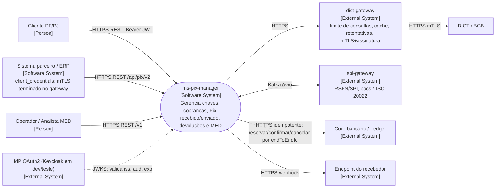
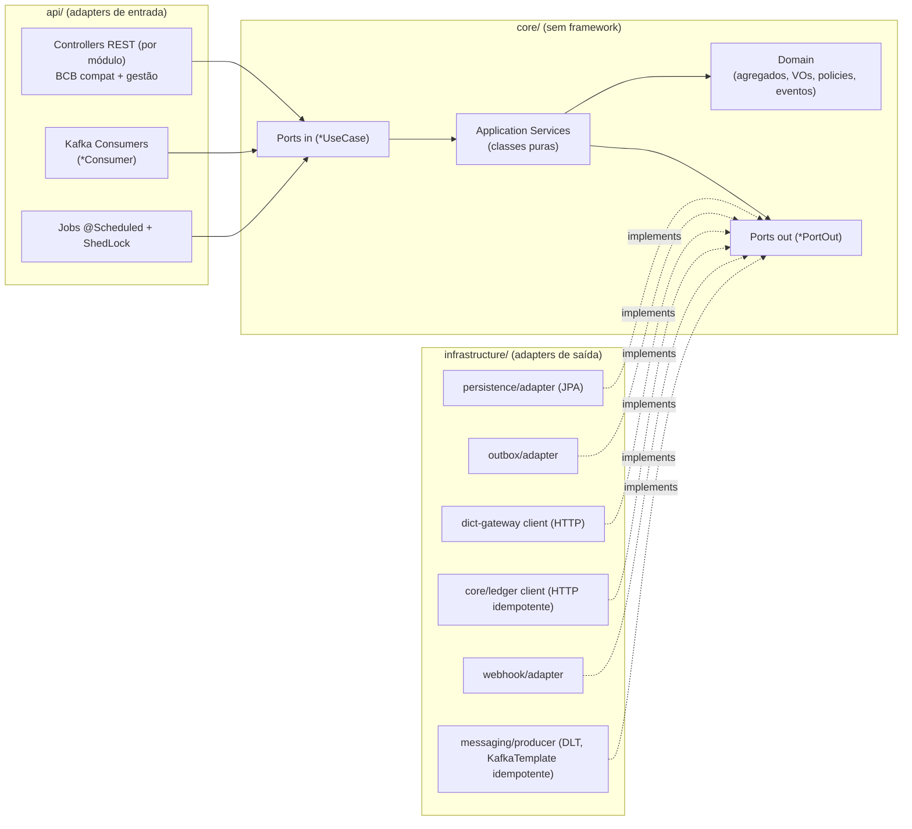
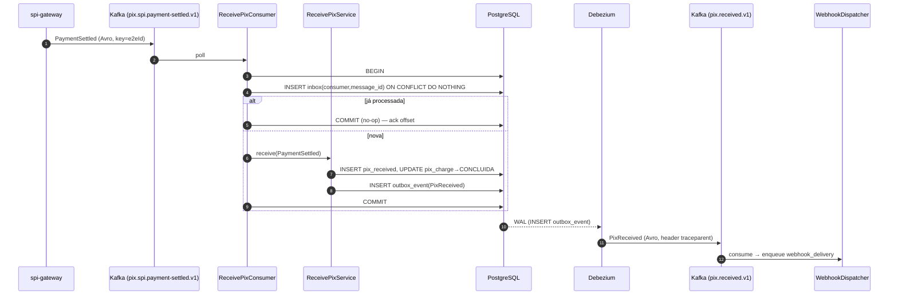
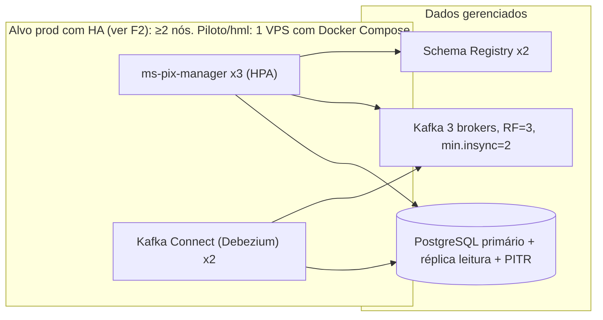

# 03 — Arquitetura (Hexagonal + C4 + ADRs)

> Skills: `architecture-conventions`, `architecture-review`, `c4-model`, `solid-principles`, `design-patterns`, `cqrs-architecture`, `spring-boot-patterns`, `java-migration`, `maven-dependency-audit`.
> Regra do C4: diagrama descreve **o que existe/será construído nesta spec**, nunca desejo. O que ficou de fora está em "Limites conhecidos" (§1.6). **Sem Nível 4 (Code)**: envelhece rápido; leia o código e esta convenção.

## 1. Diagramas C4 (diagram-as-code, Mermaid — diffável)

### 1.1 Nível 1 — Contexto


### 1.2 Nível 2 — Container
```mermaid
flowchart TB
  subgraph pixsys["ms-pix-manager"]
    api["API + Workers<br/>[Container: Java 21, Spring Boot 3]<br/>1 JAR: REST, consumers Kafka, jobs, dispatcher de webhook"]
    pg[("PostgreSQL 16<br/>[Container]<br/>dados + outbox + inbox")]
  end
  dbz["Debezium (Kafka Connect)<br/>[Container]<br/>Outbox Event Router"]
  kafka["Apache Kafka<br/>[Container]"]
  sr["Schema Registry<br/>[Container]"]
  kui["Kafka UI<br/>[Container]"]
  otel["OpenTelemetry Collector<br/>[Container]"]
  tempo["Tempo (traces)"]
  loki["Loki (logs)"]
  prom["Prometheus + Alertmanager + Grafana<br/>[Container]"]
  api -->|JDBC, HikariCP| pg
  pg -->|WAL logical decoding (pgoutput)| dbz
  dbz -->|produce Avro (idempotent)| kafka
  api -->|consume / produce DLT| kafka
  api -->|schemas Avro| sr
  kafka --- sr
  kui --> kafka
  kui --> sr
  api -->|OTLP gRPC: traces, métricas, logs| otel
  otel --> tempo
  otel --> loki
  prom -->|scrape /actuator/prometheus| api
  prom -->|scrape kafka-exporter| kafka
```
> O JAR **também hospeda** consumers, jobs e dispatcher (um deployable na v1); eles escalam por réplica (consumer group). Separar em containers é decisão de §8 (ADR-010).

### 1.3 Nível 3 — Componente (hexagonal)


### 1.4 Dinâmico — Pix recebido (o fluxo não óbvio: sem dual-write)

Setas = quem **inicia** a chamada (consumer faz *pull*; Debezium lê o WAL).

### 1.5 Deployment (alvo de produção; Dev/Hml/Local diferem só em tamanho)


### 1.6 Limites conhecidos (por escolha, com motivo)
- Sem Redis na v1 (decisão C5): idempotência/locks no PostgreSQL → menos um ponto de falha no caminho de escrita.
- Sem diagrama de classes (Nível 4).
- `spi-gateway` e ledger são **externos**; o contrato com eles é definido aqui (`06`), mas a implementação não faz parte deste ms.
- Kubernetes/Helm/IaC: não especificados (C4).

## 2. Estrutura de pacotes — **módulos de negócio na raiz, hexagonal dentro de cada módulo** (decisão C1)

> Convenção de nomes: **tudo em inglês** (pacotes, classes, métodos, colunas, campos JSON próprios, tópicos, métricas), conforme a skill `architecture-conventions`; **termos regulatórios ficam literais** (`txid`, `endToEndId`, `ispb`, `cpf`, `cnpj`, `MED`, `DICT`, `SPI`, `pacs.*`, valores de enum e campos do BCB). Glossário completo em [`11-naming-glossary.md`](11-naming-glossary.md).

`br.com.pixmanager` é placeholder. Cada módulo é um **bounded context** com as camadas `domain`, `application`, `adapter` e só expõe o que está em `application.port` para os demais.

```
src/main/java/br/com/pixmanager/
├── pixkey/                   # DICT: chaves Pix, reivindicação (posse/portabilidade), OTP, reconciliação CID
├── charge/                   # cob (immediate), cobv (due), loc, revisões
├── receivedpix/              # Pix recebido (consumer SPI), conciliação cobrança↔Pix
├── refund/                   # devolução comum (pacs.004) e natureza MED
├── reconciliation/           # relatórios/MV de conciliação, divergências
├── payment/                  # ordens de pagamento, BR Code, orquestração reservar→confirmar|cancelar
├── scheduling/               # Pix Agendado único/recorrente (+ janela de retentativa 18–21h)
├── automaticpix/             # Pix Automático (lado pagador): autorização, cobrança recorrente, tentativas
├── limit/                    # limites, carência 24–48h, dispositivo não cadastrado, consumo atômico
├── med/                      # MED 2.0: caso, camadas (hop), bloqueio, contestação
├── webhook/                  # assinaturas, entregas, reenvio manual
└── platform/                 # transversal SEM regra de negócio
    ├── outbox/  inbox/  idempotency/  audit/  security(crypto, jwt)  observability/
    ├── error/ (GlobalExceptionHandler, ErrorCodes)  config/ (PixPolicyProperties, decorators)
    └── document/ (Cpf, Cnpj, Document — VOs compartilhados)

# estrutura interna de CADA módulo de negócio
<module>/
├── domain/               # agregados, VOs, policies, eventos de domínio — SEM framework
├── application/
│   ├── port/in/          # *UseCase
│   ├── port/out/         # *PortOut (persistência, mensageria, integrações)
│   └── service/          # *Service (classes puras, sem @Service, sem @Transactional, sem Impl)
└── adapter/
    ├── in/rest/          # *Controller (+ *ControllerImpl), *Request/*Response, *Mapper
    ├── in/messaging/     # *Consumer
    ├── in/job/           # *Job (ShedLock)
    ├── config/           # <Module>ModuleConfig (@Bean de cada *Service)
    └── out/{persistence,messaging,ledger,dictgateway,webhook,...}/   # *Adapter, *Entity, *EntityMapper, *Repository
```
Exemplo: `br.com.pixmanager.charge.domain.Charge`, `…charge.application.port.in.CreateChargeUseCase`, `…charge.application.service.CreateChargeService`, `…charge.adapter.out.persistence.ChargePersistenceAdapter`.

**Dependência entre módulos:** apenas via `application.port.in` (chamada síncrona intra-processo) ou **eventos** (outbox/Kafka). Nenhum módulo importa `domain`/`adapter` de outro. `platform` não depende de módulo de negócio; `platform.document` é o único código de domínio compartilhado (VOs `Cpf`, `Cnpj`, `Document`).
Exemplo de uso: `receivedpix` chama `charge.application.port.in.MarkChargePaidUseCase`; `payment` chama `limit…ConsumeLimitUseCase`, `pixkey…ResolveKeyUseCase`; `scheduling`/`automaticpix` **criam** ordens por `payment…CreatePaymentOrderUseCase`.

### 2.1 Regras de dependência (viram ArchUnit — `08` §5)
| # | Regra |
|---|---|
| A1 | `..domain..` e `..application..` **não** dependem de `org.springframework..`, `jakarta.persistence..`, `org.hibernate..`, `org.apache.kafka..`, `io.confluent..`, `com.fasterxml.jackson..`, `lombok..`. |
| A2 | `..domain..`/`..application..` não dependem de `..adapter..` (nem de outro módulo). |
| A3 | `..adapter.in..` não depende de `..adapter.out..` (controller/consumer/job chamam `UseCase`). |
| A4 | `..adapter.out..` não depende de `..adapter.in..`. |
| A5 | **Módulos de negócio só se enxergam por `..application.port.in..`**: `charge` não importa `receivedpix.domain`/`.adapter`, etc. |
| A6 | Sem ciclos entre módulos (`slices().matching("br.com.pixmanager.(*)..").should().beFreeOfCycles()`); `platform` não depende de módulo de negócio (`platform.document` é usado por todos). |
| A7 | Classes `*Service` em `..application.service..` não têm `@Service`/`@Component`/`@Transactional`. |
| A8 | Toda `@RestController` em `..adapter.in.rest..` tem **todos** os métodos com `@PreAuthorize` (teste de reflexão). |

### 2.2 Glossário (o que cada nome significa)
| Papel | Sufixo | Exemplo |
|---|---|---|
| Porta de entrada | `UseCase` | `CreateChargeUseCase` |
| Implementação (sem `Impl`, sem `@Service`) | `Service` | `CreateChargeService` |
| Porta de saída | `PortOut` | `ChargePersistencePortOut`, `DictPortOut` |
| Adaptador de saída | `Adapter` | `ChargePersistenceAdapter`, `DictClientAdapter` |
| Entidade JPA / mapper | `Entity` / `EntityMapper` | `ChargeEntity`, `ChargeEntityMapper` |
| Mapper REST | `Mapper` | `ChargeMapper` (DTO↔domínio) |
| Corpo HTTP | `Request` / `Response` | `CreateChargeRequest` |
| Evento de domínio | `Event` | `ChargeCreatedEvent` |
| Consumer Kafka | `Consumer` | `ReceivePixConsumer` |
| Job | `Job` | `ClaimExpirationJob` |
| Catálogo de regra | `Policy` | `RefundPolicy`, `LimitPolicy` |
| Aplicador que lança | `Guard` | `OwnershipGuard` |
| Resultado selado | `…Result` | `CreateChargeResult` |
| Testes | `Test` / `WebTest` / `IT` / `ContractTest` / `ConcurrencyTest` | ver `08` |
Verbos: `findBy…`, `existsBy…`, `save`, `create/of`, `with…` (wither imutável), `is/has/can…`, `markPaid`, `requestRefund`.

## 3. Wiring (spring-boot-patterns / architecture-conventions)
- Services são **classes puras** instanciadas com `@Bean` em `<module>/adapter/config/<Module>ModuleConfig` (um por módulo); configuração comum em `platform/config`.
- **Fronteira transacional por caso de uso** (corrige o defeito "nenhuma transação cobre o caso de uso"): `TransactionalUseCaseDecorator` (`platform/config`) envolve cada `UseCase` via `TransactionTemplate`; o core vê apenas `TransactionRunnerPortOut` quando precisa de controle explícito. **Nunca** há chamada HTTP dentro dessa transação (DICT, ledger, webhook).
- **ISPB e identidade da instituição em configuração** (`pix.institution.ispb`, `pix.institution.name`), carregados no envelope dos eventos (`ispb`) — **proibido** literal de ISPB no código (teste de grep no CI), para não bloquear multi-tenant futuro (A3).
- Configuração tipada com `@ConfigurationProperties` + `@Validated` (`PixPolicyProperties`, `DictGatewayProperties`, `CoreLedgerProperties`, `KafkaTopicsProperties`). Propriedade declarada e **não lida** é erro (teste de reflexão `AllPropertiesAreReadTest`).
- `spring.jpa.open-in-view=false`, `ddl-auto=validate`, `spring.threads.virtual.enabled=true` (ver `07` §6 para ressalvas de pool).
- Exceções: `BusinessException` (negócio, 4xx) **e** `IntegrationException` (técnica, 5xx) são **irmãs** (não herda uma da outra, para que `catch (BusinessException)` nunca engula falha técnica).

## 4. Padrões de projeto aplicados (design-patterns / solid)
Só o que existe no código (conferido em `src/main`). Tabela anterior citava classes planejadas que nunca foram criadas (`ChargeValueCalculator`, `PixKeyValidator`, `PaymentInitiationStrategy`, `MetricsUseCaseDecorator`, `InboxGuard`, `ClaimStatus`...).

| Padrão | Onde | Por quê |
|---|---|---|
| Strategy (registro por chave) | `ReservationOutcomeHandler` (`purpose()`), indexado em `ProcessReservationService` por `LedgerPurpose` | cada fluxo (pagamento, devolução) reage ao resultado da reserva sem `if` no orquestrador (OCP) |
| Strategy (`supports`) | `EventAvroConverter` (5 conversores em `infrastructure/event/outbox/converter`), escolhido em `OutboxEventPublisherAdapter` | novo evento = nova classe; sem conversor ⇒ falha explícita |
| State (enum + `canTransitionTo`) | `PixKeyStatus`, `RefundStatus`, `LedgerStatus`, `PaymentStatus`, `ChargeStatus`; cada agregado valida em `moveTo` | transições centralizadas e imutáveis |
| Factory estática | `Money.of/parseBcb`, `PaymentOrder.create`, `PixKeyValue`, `BrCode.parse`, `EndToEndId` | invariantes na criação |
| Decorator (proxy) | `TransactionalUseCases.wrap` (JDK Proxy; transação por caso de uso, core sem `@Transactional`) | cross-cutting sem anotação no core |
| Adapter / Port | `*Adapter` em `infrastructure/` (DICT, ledger, persistência, outbox, inbox) | DIP |
| Outbox (EIP) | `OutboxEventPublisherAdapter` → tabela `outbox_event` → Debezium | consistência dados + evento |
| Inbox / Idempotent Receiver (EIP) | `JdbcInboxAdapter` | exatamente-um efeito nos consumers |
| Specification | `ChargeSpecifications` | filtros de listagem compostos |
| Builder | só fora do domínio (`RestClient.builder`, builders do Avro); agregados usam fábrica estática | evita `@Builder`/`@Data` em entidade |
| Anti-padrões evitados | `@Data` em entidade, singleton estático/`getInstance`, herança entre exceção de negócio e técnica | — |

## 5. CQRS-lite (cqrs-architecture)
- Nível 1: ports `*PersistencePortOut` (escrita) e `*QueryPortOut` (leitura com projeções/`Specification`, `readOnly`); sem segundo armazenamento.
- Nível 2 pontual: `mv_pix_reconciliation_daily` (materialized view, `REFRESH … CONCURRENTLY` por job com ShedLock) para o relatório de conciliação — tolerância a defasagem 5 min.
- Nível 3 (read store separado) **não** adotado: não há problema medido (checklist da skill).

## 6. Idempotência e consistência — resumo das decisões
1. **HTTP**: `Idempotency-Key` persistido em `idempotency_record` (chave + `request_hash` + resposta) — replay devolve a resposta original; chave **não** é queimada em falha técnica (status `IN_PROGRESS` com TTL/lease, `COMPLETED` só após commit).
2. **Eventos de saída**: outbox na mesma transação (Debezium publica).
3. **Eventos de entrada**: inbox na mesma transação do efeito.
4. **Chamadas externas** (ledger, DICT): chave de idempotência própria (`ledger_reservation.id`, `dict_request_id`) + sweeper de órfãos.

## 7. Locks e concorrência (concurrency-review)
- `@Version` em `pix_charge`, `pix_key`, `pix_refund`, `payment_order`, `med_case`, `webhook_subscription`.
- `SELECT … FOR UPDATE SKIP LOCKED` nas filas do dispatcher e sweepers (sem Redis).
- Jobs `@Scheduled` com **ShedLock** (tabela `shedlock`) — nunca um por instância.
- Soma de devoluções protegida por `SELECT … FOR UPDATE` do `pix_received` (linha-semáforo) **e** `CHECK` de agregado via trigger-less `UPDATE pix_received SET refunded_total = refunded_total + :v WHERE refunded_total + :v <= refundable_amount` (atômico, retorna 0 linhas ⇒ excedeu).
- Virtual threads: pool Hikari dimensionado explicitamente (§`07`); `ThreadLocal`/MDC limpos em `finally`.

## 8. ADRs (decisões e trade-offs)

| ADR | Decisão | Alternativas | Consequência |
|---|---|---|---|
| 001 | Hexagonal com domínio sem framework | MVC em camadas | Mais classes; testes de unidade sem Spring; ArchUnit garante |
| 002 | Entidade JPA ≠ domínio | `@Entity` no domínio | Dois mappers (MapStruct) |
| 003 | Rotas BCB **literais** em `/api/pix/v2` (singular, pt: `cob`, `cobv`, `pix`, `loc`, `webhook`) e gestão própria em `/v1/…` (plural, kebab-case) | Tudo plural próprio | Compat com clientes padrão BCB; duas convenções documentadas |
| 004 | PostgreSQL + Liquibase SQL puro com `--rollback` | Flyway / JPA ddl-auto | Reversão e revisão de DDL explícitas |
| 005 | Outbox + **Debezium** (CDC) em vez de poller | Poller `@Scheduled`; `@TransactionalEventListener` | Latência baixa, ordem por agregado; exige Kafka Connect e `wal_level=logical` |
| 006 | Payload da outbox = **bytes Avro** (wire format Confluent) + `ByteArrayConverter` no connector | JSON na outbox + `AvroConverter` do Connect | Schema governado na origem; connector é pass-through; consumidores usam `KafkaAvroDeserializer` |
| 007 | Inbox por `INSERT … ON CONFLICT DO NOTHING` na mesma transação do efeito | Dedup em memória/Redis | Exatamente-um efeito; tabela com limpeza por retenção |
| 008 | Retry: `@RetryableTopic` (non-blocking, tópicos `-retry-N`) para falha **técnica**; negócio ⇒ DLT direto | Blocking retry | Não bloqueia partição; ordem por chave pode ser quebrada ⇒ apenas para handlers idempotentes (todos são) |
| 009 | Springwolf (AsyncAPI gerado do código) | AsyncAPI manual | Documentação nunca obsoleta; precisa de `@AsyncListener/@AsyncPublisher` |
| 010 | Um deployable na v1 | Separar `api`/`worker`/`dispatcher` | Simples; separar quando lag/CPU divergirem (métrica) |
| 011 | Sem Redis na v1 (C5) | Redis para cache/lock/idempotência | Menos dependências; locks via `SKIP LOCKED`/ShedLock; cache de consultas DICT fica no **dict-gateway**; Redis só depois, como cache de DICT |
| 014 | **Módulos de negócio na raiz com hexagonal por módulo** (C1) | Hexagonal global com camadas na raiz | Fronteiras claras entre contextos; mais pacotes; ArchUnit A5/A6 impedem acoplamento |
| 015 | DICT **somente** via `dict-gateway`; SPI **somente** via `spi-gateway`; core via API idempotente (A1/A2) | Cliente DICT/SPI embutido | O ms não implementa mTLS/XMLDSig/rate limit do DICT; ganha simplicidade, perde controle fino ⇒ contrato dos gateways é crítico (`10` E2) |
| 016 | ms = **OAuth2 Resource Server** puro (C2) | ms emite tokens | Sem cadastro de cliente no ms; escopos do BCB + `pii.document.read`; Keycloak só em dev/teste |
| 017 | Reserva em 2 fases no core: `reservar → confirmar \| cancelar` por `endToEndId` (A2) | Débito direto | Idempotente; sweeper repara reservas órfãs |
| 012 | Chave Pix `CPF` armazenada criptografada + hash cego | texto puro | Busca por igualdade só via hash; sem `LIKE` |
| 013 | Sem `DELETE` com corpo; cancelamentos e transições via `POST …/cancellation`, `…/closure` | `DELETE` + body | Compatível com proxies/gateways (RFC 9110 §9.3.5); a superfície BCB só usa `DELETE` sem corpo (`/loc/{id}/txid`, `/webhook/{chave}`) |

## 9. Stack, versões e auditoria (`java-migration`, `maven-dependency-audit`)
| Item | Decisão | Nota |
|---|---|---|
| Java | **21 LTS** (`java.version=21`), sem `--enable-preview` | Caminho 21→25 já mapeado (JaCoCo/ByteBuddy/Lombok-free no core) |
| Spring Boot | **3.5.x** (última linha 3.x) via `spring-boot-starter-parent` | **Risco:** confirmar janela de suporte OSS da 3.5 com `maven-dependency-audit` e planejar 4.x; não fixar versões que o BOM gerencia |
| Kafka client / Spring Kafka | via BOM do Boot | `spring-kafka`, `kafka-avro-serializer` + `kafka-schema-registry-client` (Confluent Maven repo) |
| Avro | `org.apache.avro:avro` + `avro-maven-plugin` (gera classes de `src/main/resources/avro/*.avsc`) | `BACKWARD_TRANSITIVE` |
| Debezium | `quay.io/debezium/connect` (imagem) + SMT `io.debezium.transforms.outbox.EventRouter` | fixar tag exata no compose |
| Liquibase | via BOM | changelog em `db/changelog` |
| MapStruct | pinned (`1.6.x`) | fora do BOM |
| Springwolf | `springwolf-kafka` + `springwolf-ui` | pinned |
| Resilience4j | `resilience4j-spring-boot3` | pinned; breaker ignora `BusinessException`; usado nos clientes do dict-gateway/core/webhook |
| ShedLock | `shedlock-spring` + `shedlock-provider-jdbc-template` | pinned |
| Micrometer/OTel | `micrometer-tracing-bridge-otel`, `opentelemetry-exporter-otlp`, `micrometer-registry-prometheus` | via BOM |
| springdoc | `springdoc-openapi-starter-webmvc-ui` | pinned |
| Testes | JUnit 5, AssertJ, Mockito, Testcontainers (`postgresql`, `kafka`, `junit-jupiter`), WireMock, ArchUnit, Awaitility, Gatling | ver `08` |

Auditoria: `mvn versions:display-dependency-updates`, `mvn dependency:tree`, `dependency-check` no CI (falha em CVSS ≥ 7); versões pinadas exigem comentário "por que fora do BOM".
