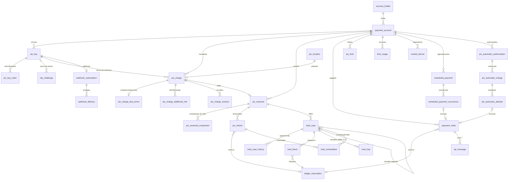

# 04 — Modelo de dados (PostgreSQL 16 + Liquibase)

> Atualizado em 2026-10-15 (rodada 1 de respostas). Fonte da verdade do DDL: `db/changelog/changes/001…011-*.sql` (SQL puro com `--rollback`). **Validado em 2026-10-15** aplicando os 11 arquivos em um `postgres:16-alpine` (`wal_level=logical`) descartável: **37 tabelas + 1 materialized view**, sem erros; constraints exercitadas. Este documento explica o *porquê*.
> Skills: `jpa-patterns`, `security-audit`, `cqrs-architecture`, `concurrency-review`.
> Modelagem **depois** da leitura da API Pix 2.10.0 e DICT 2.12.1 (`09`): tipos, tamanhos, padrões e enums vêm do OpenAPI oficial.

## 1. Diagrama (ERD)


Tabelas transversais sem FK de domínio: `outbox_event`, `inbox_message`, `idempotency_record`, `audit_log`, `dict_sync_state`, `shedlock`. View: `mv_pix_reconciliation_daily`.

## 2. Catálogo de tabelas (37 + 1 MV)

| # | Tabela | Responsabilidade | Chaves / unicidade críticas | Concorrência |
|---|---|---|---|---|
| 1 | `account_holder` | Titular (CPF/CNPJ criptografado) | `uk(document_hash)` | `@Version` |
| 2 | `payment_account` | Conta (ISPB/agência/número/tipo ISO 20022) | `uk(ispb, branch, account_number, account_type)` | `@Version` |
| 3 | `pix_key` | Chave DICT (valor criptografado + hash) | `uk(key_hash) WHERE status NOT IN (DELETED, REJECTED)` | `@Version` |
| 4 | `pix_key_claim` | Reivindicação posse/portabilidade, 2 papéis | `uk(dict_claim_id, role)`, `uk(key_hash, role) WHERE aberta` | `@Version` |
| 5 | `otp_challenge` | Prova de posse (hash do código) | — | tentativas atômicas |
| 6 | `dict_sync_state` | Resultado da reconciliação CID | pk escopo | — |
| 7 | `pix_location` | `loc` (id numérico da API + token de URL) | `uk(location_id)`, `uk(url_path)` | sequência `seq_pix_location_id` (`allocationSize=50`) |
| 8 | `pix_charge` | `cob` (IMMEDIATE) e `cobv` (DUE) | **`uk(receiver_document_hash, txid)`** | `@Version` |
| 9 | `pix_charge_due_terms` | Multa, juros, abatimento, desconto | pk = charge | — |
| 10 | `pix_charge_additional_info` | `infoAdicionais` (≤50) | pk(charge, position) | — |
| 11 | `pix_charge_revision` | Snapshot a cada PATCH | pk(charge, revision) | — |
| 12 | `pix_received` | Pix recebido | **`uk(end_to_end_id)`**; `CHECK refunded_total ≤ refundable_amount` | `@Version` + UPDATE condicional |
| 13 | `pix_received_component` | Composição do valor | pk(received, tipo) | — |
| 14 | `pix_refund` | Devolução (id do cliente + `rtrId`) | `uk(end_to_end_id, refund_id)`, `uk(rtr_id)` | `@Version` |
| 15 | `webhook_subscription` | 1 URL por chave | `uk(key_hash)` | `@Version` |
| 16 | `webhook_delivery` | Fila de entrega | `uk(subscription_id, source_event_id)` | `SKIP LOCKED` |
| 17 | `ledger_reservation` | Reserva em 2 fases no core (`reservar → confirmar \| cancelar`) | `uk(idempotency_key, purpose)` — **idempotency_key = `endToEndId`** | `@Version` + sweeper |
| 18 | `payment_order` | Pix enviado | `uk(end_to_end_id)` parcial | `@Version` |
| 19 | `spi_message` | Trilha pacs.008/002/004 | `uk(direction, msg_id)` | — |
| 20 | `pix_limit` | Limites por conta/escopo (+ teto do banco, aumento pendente 24–48 h, dispositivo não cadastrado) | `uk(account_id, scope)`; `CHECK amount <= ceiling` | `@Version` |
| 21 | `limit_usage` | Consumo diário/noturno | pk(conta, dia, escopo) | UPDATE condicional atômico |
| 22 | `med_case` | Caso MED (`layer`, `parent_case_id`) | `uk(dict_funds_recovery_id, role)` | `@Version` |
| 23 | `med_case_history` | Histórico **append-only** (trigger) | — | imutável |
| 24 | `med_block` | Bloqueio cautelar | — | `@Version` |
| 25 | `outbox_event` | Eventos de saída (Avro bytes) | pk = eventId | insert-only |
| 26 | `inbox_message` | Dedup de consumers | `uk(consumer_group, message_id)` | `INSERT … ON CONFLICT` |
| 27 | `idempotency_record` | Idempotency-Key HTTP | `uk(client_id, operation, key)` | lease `locked_until` |
| 28 | `audit_log` | Auditoria **append-only** (trigger) | — | imutável |
| 29 | `shedlock` | Lock de jobs | pk nome | — |
| 30 | `trusted_device` | Dispositivos cadastrados (limites de não cadastrado) | `uk(account_id, device_hash)` | `@Version` |
| 31 | `med_hop` | Salto/camada do rastreamento MED 2.0 (bloqueado/devolvido parcial) | `CHECK blocked+refunded <= tracked` | `@Version` + UPDATE condicional |
| 32 | `med_contestation` | Contestação do recebedor (80 d da devolução) | `uk(refund_id) WHERE OPEN` | `@Version` |
| 33 | `scheduled_payment` | Pix Agendado (único/recorrente) | — | `@Version` |
| 34 | `scheduled_payment_occurrence` | Ocorrência por data + retry 18–21h | `uk(scheduled_payment_id, sequence_no)` | `SKIP LOCKED` + `@Version` |
| 35 | `pix_automatic_authorization` | Autorização/recorrência (`idRec` 29, estados API Pix) | `uk(id_rec)` | `@Version` |
| 36 | `pix_automatic_charge` | Cobrança recorrente (`CobR`) | `uk(authorization_id, txid)` | `@Version` |
| 37 | `pix_automatic_attempt` | Tentativas (`AGND/NTAG/RIFL`) com `endToEndId` próprio | `uk(end_to_end_id)` | — |
| MV | `mv_pix_reconciliation_daily` | Conciliação por dia/status (CQRS-lite) | `uk(day, status)` p/ `REFRESH CONCURRENTLY` | job + ShedLock |

## 3. Decisões de modelagem (e por quê)

### 3.1 Identidade e tempo
- **PK = UUID gerado pela aplicação**, preferencialmente **UUIDv7** (ordenável por tempo → menos fragmentação de índice B-tree que v4). Java 21 não tem v7 nativo → gerador injetável (`IdGeneratorPortOut`, impl. com biblioteca `uuid-creator`); testes usam gerador determinístico. Sem `IDENTITY` (desabilita batch do Hibernate).
- `timestamptz` em todo lugar; app em UTC; relatórios convertem para `America/Sao_Paulo` (a MV usa `AT TIME ZONE` explícito — o contrato diz **qual** fuso define o "dia").
- `Clock` injetado; `expires_at` calculado na app (coluna gerada com `timestamptz + interval` não é `IMMUTABLE` no PostgreSQL).

### 3.2 Dinheiro
- `numeric(12,2)` nos valores Pix (BCB: `\d{1,10}\.\d{2}`); `numeric(15,2)` em limites/reservas (somas). Em Java: `Money` (VO sobre `BigDecimal`, `RoundingMode.HALF_EVEN`, escala 2). Nunca `double`.

### 3.3 Estados
- `varchar + CHECK` em vez de `ENUM` do PostgreSQL (alterar um `ENUM` exige DDL com bloqueio e não dá `ALTER TYPE … DROP VALUE`); JPA `@Enumerated(STRING)`.
- Os valores dos enums do BCB são preservados **literalmente** (`ATIVA`, `CONCLUIDA`, `REMOVIDA_PELO_USUARIO_RECEBEDOR`, `EM_PROCESSAMENTO`, `DEVOLVIDO`, `NAO_REALIZADO`) pois são *wire values* (renomear quebra clientes).
- Consistência de estado reforçada no banco (`ck_pix_charge_removed`, `ck_pix_refund_settled`, `ck_payment_order_rejected`, `ck_pix_key_deleted`).

### 3.3b Ledger em duas fases e `endToEndId`
- `payment_order.end_to_end_id` é `NOT NULL` e **gerado na criação** (formato Pix `E` + ISPB(8, de configuração) + data/hora + 11 aleatórios, 32 chars). É a chave de idempotência enviada ao core em `reservar/confirmar/cancelar` (`ledger_reservation.idempotency_key`).
- `ledger_reservation.status`: `PENDING` (intenção gravada na TX) → `RESERVED` → `CONFIRMED` | `CANCELLED` | `FAILED`. Bloqueio MED usa `med-<caseId>-<n>`; devolução usa o e2e/rtr da devolução.
- Limites: `pix_limit.ceiling_amount` (teto do banco), `pending_amount` + `pending_requested_at` + `pending_effective_at` (aumento só vale em **24–48 h**), redução imediata; novos escopos `DEVICE_UNREGISTERED_PER_TX` e `DEVICE_UNREGISTERED_DAILY` (R$ 200 / R$ 1.000) com `payment_order.device_registered`.

### 3.4 PII (LGPD) e CPF
| Dado | Armazenamento | Busca | Exposição |
|---|---|---|---|
| CPF/CNPJ do titular, devedor, pagador | `*_document_enc` (AES-256-GCM, IV aleatório por valor) | `*_document_hash` (HMAC-SHA256 com chave separada da de cifra) | `*_masked` / `***.456.789-**` |
| Valor da chave Pix (CPF/PHONE/EMAIL) | `key_value_enc` | `key_hash` | `key_masked` |
| Nome | texto (necessário ao produto) | — | mascarado em logs |
- Chaves em cofre (KMS/Vault), **rotação** com `key_version` no prefixo do ciphertext (`v1:…`); *crypto-shredding* por titular é **backlog e só após o prazo legal de retenção** (exclusão LGPD não prevalece sobre retenção obrigatória — B7).
- CPF/CNPJ completo só é devolvido com o escopo `pii.document.read` (todo acesso gera `audit_log`).
- Falha na obtenção da chave ⇒ **a aplicação não sobe** (fail-fast); o `AttributeConverter` **nunca** grava texto puro como fallback (defeito registrado em `jpa-patterns`).
- Toda coluna com conversor reavalia índices/`WHERE` (lição da skill): buscas sempre pelo `*_hash`.
- Eventos Avro e `webhook_delivery.payload` carregam **CPF mascarado ou hash**, nunca em claro; o webhook BCB padrão não inclui o CPF do pagador além do que a API exige — o conteúdo é derivado do OpenAPI (`pix[].pagador` opcional), configurável por assinante.

### 3.5 Unicidade e idempotência (o que o banco garante sozinho)
| Garantia | Mecanismo |
|---|---|
| `txid` único **por documento do recebedor** | `uk_pix_charge_receiver_txid` |
| Pix recebido processado uma vez | `uk_pix_received_e2e` + `inbox_message` |
| Devolução idempotente por `(e2e, id)` | `uk_pix_refund_e2e_refund` + `request_hash` |
| Uma chave viva por valor | `uk_pix_key_live_hash` (parcial) |
| Uma claim aberta por chave/papel | `uk_pix_key_claim_open_per_key` (parcial) |
| Entrega de webhook sem duplicar | `uk_webhook_delivery_event` |
| Idempotency-Key HTTP | `uk_idempotency_scope` |
| Σ devoluções ≤ devolvível | `ck_pix_received_refund_cap` + `UPDATE … WHERE refunded_total + :v <= refundable_amount` |
| Consumo de limite sem corrida | `UPDATE limit_usage SET used_amount = used_amount + :v WHERE used_amount + :v <= :limit` |

### 3.6 Índices (um para cada consulta real)
| Consulta | Índice |
|---|---|
| `GET /cob?inicio&fim&cpf&status` | `idx_pix_charge_search (receiver_account_id, created_at DESC)`, `idx_pix_charge_debtor`, `idx_pix_charge_status_created` |
| Job de expiração/varredura de cobranças ativas | `idx_pix_charge_expires_active`, `idx_pix_charge_due_date` (parciais) |
| `GET /pix?inicio&fim&txid&cpf` | `idx_pix_received_account_settled`, `idx_pix_received_txid`, `idx_pix_received_payer_doc` |
| Alerta de conciliação | `idx_pix_received_recon` (parcial `<> MATCHED`) |
| Dispatcher de webhook | `idx_webhook_delivery_due` (parcial; `FOR UPDATE SKIP LOCKED`) |
| Sweepers (ledger, pagamento, refund, chave pendente, claim a expirar) | índices parciais `*_sweeper`, `*_pending`, `*_expiration` |
| Purge | `idx_outbox_event_created`, `idx_inbox_processed`, `idx_idempotency_expires` |
Revisão obrigatória (checklist `jpa-patterns`): sem índice para filtro de escopo (ex.: "ver apenas minhas cobranças") → o filtro de escopo usa `receiver_account_id` (já indexado, primeiro campo).

### 3.7 Particionamento, volume e retenção
- Estimativa v1: 5 M Pix recebidos/mês ⇒ ~60 M/ano em `pix_received`. Sem particionamento na v1 porque `uk(end_to_end_id)` global **não pode** ser garantido numa tabela particionada por data (a PK/unique precisa incluir a chave de partição). Mitigação: `pg_partman` por hash de `end_to_end_id` **ou** registro `pix_e2e_registry` + particionamento por data (backlog B-DB1) quando passar de ~300 M linhas / 150 GB.
- Retenção: transações ≥ 5 anos (B7); `outbox_event` 3 dias; `inbox_message` 14 dias (> retenção do tópico); `idempotency_record` 24 h–7 d; `audit_log` 5 anos; `otp_challenge` 30 dias.
- Purge em lotes (`DELETE … WHERE id IN (SELECT id … LIMIT 5000)`) por job com ShedLock; sem `VACUUM FULL`; `autovacuum` agressivo em `outbox_event`/`inbox_message`/`webhook_delivery`.

### 3.8 JPA (jpa-patterns aplicadas)
- Sem associações `@OneToMany` bidirecionais; FKs como `UUID` escalar → sem N+1 e sem `LazyInitializationException` por construção; leitura de listas via **projeções** (`interface projection`/`record` DTO) e `Specification` composta.
- `@Version` em todo agregado mutável; **`saveAndFlush`** dentro do `try` que traduz `ObjectOptimisticLockingFailureException` → `PIX-412-001` (412).
- `UPDATE` em massa (varreduras) incrementam `version = version + 1` e respeitam a máquina de estados (lição do `cancelNonTerminalByBatch`).
- `readOnly = true` em todas as leituras; `hibernate.jdbc.batch_size=50`, `order_inserts=true`; sequence `allocationSize=50` quando necessário.
- Entidades nunca saem do adapter (mapeadas para domínio dentro da transação). `open-in-view=false`.
- `ddl-auto=validate` + Liquibase em todos os ambientes; teste `*IT` roda o changelog real (nada de H2).

## 4. Como rodar/validar o DDL localmente
```bash
docker run --rm -e POSTGRES_PASSWORD=x -p 127.0.0.1:55432:5432 postgres:16-alpine  # wal_level=logical se for testar Debezium
# aplicar na ordem (sem as linhas --liquibase/--changeset/--rollback) ou via Liquibase:
liquibase --changelog-file=db/changelog/db.changelog-master.yaml --url=jdbc:postgresql://localhost:55432/postgres update
```
Teste de regressão (`08`): `LiquibaseSchemaIT` aplica o changelog, executa **rollback** de cada changeset e reaplica.

## 5. Evolução do esquema (regras de migração)
1. Changesets **imutáveis** depois de merge (novo arquivo para qualquer mudança).
2. Compatibilidade *expand/contract*: adicionar coluna nullable → deploy app que escreve nos dois → backfill → tornar `NOT NULL` → remover antiga em release posterior.
3. `CREATE INDEX CONCURRENTLY` em tabelas grandes (`runInTransaction:false`).
4. Todo changeset com `--rollback` testado.
